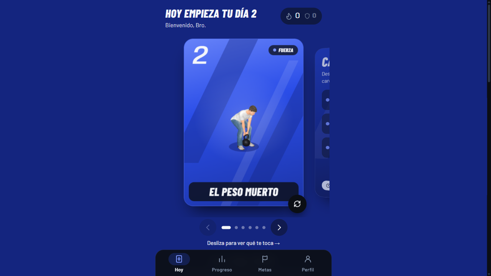

<div align="center">


<a href="https://kettellbro.vercel.app"></a>

<a href="https://kettellbro.vercel.app"></a>

</div>

## 🧭 Overview
An installable web app (PWA) that acts as a kettlebell coach: a new 10–25 minute workout every day, with research cited for each block and set-by-set guidance.

## ✨ Features
- A new research-backed workout each day
- Set-by-set guidance
- Installable PWA
- Firebase backend

## 🛠️ Built with
`Next.js` · `TypeScript` · `Firebase` · `PWA`

## 🚀 Run locally
```bash
npm install
npm run dev
```


---

<div align="center">
<sub>Made by <b>Rodrigo Negrete</b> — AI Product Designer &amp; Automation Architect<br/>
<a href="https://www.rodrigonegrete.es">Portfolio</a> · <a href="https://linkedin.com/in/rodrigonegretearos">LinkedIn</a> · <a href="https://github.com/Ronegret">GitHub</a></sub>
</div>
