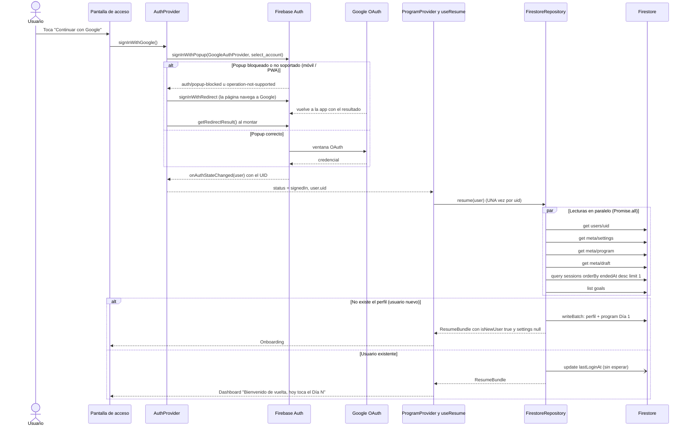

# Arquitectura de datos y autenticación de kettellbro

> Alcance: acceso con Google, carga inicial ("Bienvenido de vuelta, hoy toca el Día N"), modelo de
> datos en Firestore, reglas de seguridad, caché offline y costos. Todo el código citado vive en
> `src/lib/firebase`, `src/lib/data` y `src/components` (`AuthProvider`, `ProgramProvider`).

## 1. Resumen de decisiones

| Tema | Decisión | Motivo |
| --- | --- | --- |
| Acceso | **Solo Google** (sin email/contraseña, sin anónimo) | Sin contraseñas que custodiar; un toque en el móvil. |
| Backend | Firebase Auth + Cloud Firestore (SDK modular v13) | Caché offline persistente y cola de escrituras integradas; sin servidor propio. |
| Estado del usuario | Subárbol `users/{uid}/…` | Reglas triviales (`request.auth.uid == uid`) y lecturas por ruta. |
| Offline | `persistentLocalCache` + `persistentMultipleTabManager` | El gimnasio tiene mala cobertura; la app debe abrir y registrar sin red. |
| Cierre de sesión de entrenamiento | `writeBatch` único (atómico, funciona offline) | Una transacción exige conexión. |
| Fechas | `number` (epoch ms), nunca `Timestamp` | Los tipos del motor son puros y sirven igual en `localStorage`. |
| Modo demo | `NEXT_PUBLIC_DEMO_MODE=1` => `LocalRepository` | Previsualizar la UI sin Firebase. **Nunca en producción.** |

Dos implementaciones intercambiables del mismo contrato (`src/lib/data/repository.ts`):

```
            ┌──────────────────────────┐
  UI  ───►  │ useAuth()  useProgram()  │   (contextos de React)
            └────────────┬─────────────┘
                         │ getRepository()
            ┌────────────┴─────────────┐
            │   interface Repository   │
            └──────┬────────────┬──────┘
                   │            │
     FirestoreRepository    LocalRepository
     (producción)           (solo DEMO_MODE, localStorage)
```

## 2. Flujo "Continuar con Google" → Dashboard



Máquina de estados de `useAuth().status`:

```
                 faltan NEXT_PUBLIC_FIREBASE_* (y no es demo)
   (arranque) ──────────────────────────────────────────────► misconfigured
       │
       ▼
    loading ── onAuthStateChanged(null) ──► signedOut ── signInWithGoogle ──┐
       │                                        ▲                           │ popup o redirect
       └─ onAuthStateChanged(user) ─────────────┼───────────────────────────┘
                                                │            │
                                  signOut() ────┘            ▼
                                                         signedIn
```

## 3. Autenticación

Archivos: `src/lib/firebase/client.ts`, `src/lib/firebase/auth.ts`, `src/components/auth/AuthProvider.tsx`.

- **Inicialización perezosa y singleton** (`client.ts`). Nada corre al importar el módulo, así que
  `next build` no falla aunque no haya variables de entorno. `getFirebaseApp/Auth/Db()` devuelven
  `null` si Firebase no está configurado.
- **Persistencia de sesión**: se usa `initializeAuth` con `[indexedDBLocalPersistence, browserLocalPersistence]`
  y `browserPopupRedirectResolver`. Se fija al crear la instancia (no con `await setPersistence`)
  porque ese `await` antes del popup hace que Safari/iOS lo bloquee al perder el gesto del usuario.
- **Popup con respaldo a redirección**. `signInWithPopup` primero; si falla con
  `auth/popup-blocked` o `auth/operation-not-supported-in-this-environment` (típico en móvil y PWA
  instalada) se llama a `signInWithRedirect`. Al montar, `getRedirectResult()` recoge errores de la
  vuelta. **Cerrar el popup NO es un error**: `authErrorMessage()` devuelve `null` y no se muestra nada.
- **Mensajes en español** para: popup bloqueado, sin red, dominio no autorizado, proveedor
  deshabilitado, cuenta deshabilitada, demasiados intentos, almacenamiento bloqueado y genérico.

Fragmento clave (`src/lib/firebase/auth.ts`):

```ts
export async function signInWithGoogle(): Promise<void> {
  const auth = requireAuth();
  const provider = new GoogleAuthProvider();
  provider.setCustomParameters({ prompt: "select_account" }); // siempre pregunta qué cuenta usar
  try {
    // Sin `await` antes: conserva el gesto del usuario y el navegador no bloquea el popup.
    await signInWithPopup(auth, provider);
  } catch (error) {
    const code = authErrorCode(error);
    if (code === "auth/popup-blocked" || code === "auth/operation-not-supported-in-this-environment") {
      await signInWithRedirect(auth, provider); // la página se descarga y vuelve de Google
      return;
    }
    throw error; // popup cerrado por el usuario => AuthProvider lo ignora (no es error)
  }
}
```

> ⚠️ **Redirección en hosting que no es Firebase Hosting (p. ej. Vercel).** Los navegadores que
> bloquean almacenamiento de terceros rompen `signInWithRedirect` si `authDomain` es
> `<proyecto>.firebaseapp.com` y la app vive en otro dominio. Opciones de la documentación oficial
> ([redirect best practices](https://firebase.google.com/docs/auth/web/redirect-best-practices)):
> usar solo popup, o **servir el handler desde tu propio dominio**: pon `authDomain` = tu dominio
> y reenvía de forma transparente (no con 302) `/__/auth/*` y `/__/firebase/*` a
> `<proyecto>.firebaseapp.com`, por ejemplo con `rewrites()` en `next.config.ts`:
>
> ```ts
> async rewrites() {
>   const host = `${process.env.NEXT_PUBLIC_FIREBASE_PROJECT_ID}.firebaseapp.com`;
>   return [
>     { source: "/__/auth/:path*", destination: `https://${host}/__/auth/:path*` },
>     { source: "/__/firebase/:path*", destination: `https://${host}/__/firebase/:path*` },
>   ];
> },
> ```
>
> y añade `https://<tu-dominio>/__/auth/handler` como URI de redirección autorizada del cliente
> OAuth en Google Cloud. **No está aplicado en `next.config.ts` y no se pudo probar aquí**: verifícalo
> en un móvil real (iOS Safari y Chrome Android) antes de producción.

### Modo demo (solo desarrollo)

Con `NEXT_PUBLIC_DEMO_MODE=1`, `AuthProvider` **no usa Firebase**: expone un usuario ficticio
(`uid: "demo-user"`, `displayName: "Bro Demo"`) persistido en `localStorage` (`kb:v1:demo:user`) y
`getRepository()` devuelve `LocalRepository`.

> ⛔ **`DEMO_MODE` nunca debe usarse en producción**: cualquiera entra sin autenticarse y los datos
> no salen del navegador. En producción la variable debe estar **vacía**. El contexto expone
> `isDemo` para pintar un aviso "MODO DEMO" y, si se activa en un build de producción, se emite un
> `console.warn`. Si `DEMO_MODE` es falso y faltan las variables de Firebase, el estado es
> `misconfigured` (la UI debe explicar cómo configurarlo, no dejar pasar).

## 4. Modelo de datos en Firestore

```
users/{uid}                              UserProfileDoc   (1 doc)
 ├─ meta/settings                        UserSettings     (1 doc)
 ├─ meta/program                         ProgramState     (1 doc: "el Día N" y toda la progresión)
 ├─ meta/draft                           ActiveSessionDraft (0..1 doc: sesión en curso)
 ├─ sessions/{sessionId}                 SessionLog       (N docs, inmutables)
 ├─ records/{exerciseId}                 PersonalRecord   (≤ 30 docs)
 └─ goals/{goalId}                       GoalCompletionDoc (≤ nº de metas, inmutables)
```

| Documento | Campos principales | Escritura |
| --- | --- | --- |
| `users/{uid}` | `displayName`, `email`, `photoURL`, `createdAt`, `lastLoginAt`, `schemaVersion` | crear al primer login; `lastLoginAt` en cada arranque |
| `meta/settings` | `level`, `primaryGoal`, `minutes` (10/15/20/25), `bells[]`, `hasPairs`, `referenceKg`, `body` (estatura, historial de pesajes y fecha de la última revisión de pesas; opcional), `lowBackCare`, `voice/sound/haptics`, `onboardedAt` | onboarding / ajustes |
| `meta/program` | `dayIndex`, `streak`, `bestStreak`, `shields`, `xp`, `totals`, `memory` (por ejercicio), `lastRpe`, `lastFeel`, `lastSessionDate`, `schemaVersion` | se **reemplaza** al cerrar cada sesión |
| `meta/draft` | `plan` (SessionPlan completo), `startedAt`, `stepIndex`, `sets[]`, `updatedAt` | cada paso (con limitador de frecuencia); se borra al terminar |
| `sessions/{id}` | `SessionLog` completo; **id = `s${dayIndex}-${startedAt}`** | solo `create` |
| `records/{exerciseId}` | `bellKg`, `reps`, `dayIndex`, `date` | solo si se mejora (pesa y luego repeticiones) |
| `goals/{goalId}` | `id`, `completedAt` | solo `create` |

**Por qué así**

1. **Lecturas mínimas al arrancar.** Lo que pinta el Dashboard (Día N, racha, XP, ajustes) está en
   documentos pequeños y únicos (`meta/*`), no repartido en cientos de sesiones. No hay que sumar nada
   en el cliente.
2. **`meta/program` es un documento único** que se lee en una sola operación y se reemplaza entero
   en el mismo batch que registra la sesión: o se ve el estado nuevo con la sesión nueva o ninguno.
3. **Sesiones como subcolección**: crecen sin límite y se paginan con `orderBy('endedAt','desc').limit(n)`;
   nunca viajan todas. El "id determinista" hace idempotente el reintento (misma sesión = mismo documento).
4. **Borrador recuperable**: si el usuario cierra la app a mitad de entrenamiento, `resume()` lo trae
   y la UI ofrece "Continuar sesión". Vive aparte de `program` para que reescribirlo en cada paso no
   toque el estado de progresión.
5. **Récords en documentos por ejercicio**: leer/actualizar solo los ejercicios de la sesión; la lista
   completa es una sola consulta pequeña.
6. **Todo bajo el uid** → las reglas son una línea y no hay datos compartidos que filtrar por error.
7. **Epoch ms** en lugar de `Timestamp`: los tipos del motor (`types.ts`) son los mismos en Firestore y
   localStorage, sin conversiones.

Índices: las consultas usan un solo campo (`endedAt`), cubierto por los **índices automáticos** de
campo único; `firestore.indexes.json` queda vacío a propósito. Opcional para ahorrar almacenamiento:
excluir de la indexación campos grandes que nunca se consultan (`sessions.sets`, `meta.plan`) con
`fieldOverrides`.

## 5. `resume()`: la carga inicial

```ts
// src/lib/data/firestoreRepository.ts (abreviado)
async resume(user: AppUser): Promise<ResumeBundle> {
  const db = requireDb();
  const uid = user.uid;

  // 1) UNA ronda de lecturas, todas en paralelo => la latencia total es la de la más lenta.
  const [profileSnap, settingsSnap, programSnap, draftSnap, lastSessionSnap, goalsSnap] =
    await Promise.all([
      getDoc(refs.user(db, uid)),
      getDoc(refs.settings(db, uid)),
      getDoc(refs.program(db, uid)),
      getDoc(refs.draft(db, uid)),
      getDocs(query(refs.sessions(db, uid), orderBy("endedAt", "desc"), limit(1))), // solo la última
      getDocs(refs.goals(db, uid)),
    ]);

  // 2) Sin perfil => usuario nuevo: perfil + Día 1 en un writeBatch (todo o nada).
  if (!profileSnap.exists()) {
    const batch = writeBatch(db);
    batch.set(refs.user(db, uid), stripUndefined(profile));
    batch.set(refs.program(db, uid), stripUndefined(createInitialState(now)));
    await batch.commit();
    return { user, isNewUser: true, /* settings: null => falta onboarding */ … };
  }

  // 3) Usuario existente: lastLoginAt SIN esperar (no bloquea el arranque).
  void updateDoc(refs.user(db, uid), { …, lastLoginAt: now }).catch(() => {});
  return { user, isNewUser: false, settings, state, lastSession, draft, completedGoalIds };
}
```

En React, `useResume()` (`src/lib/data/useResume.ts`) llama a `resume` **una vez por uid** (resiste el
doble efecto de StrictMode y descarta respuestas tardías si cambia el usuario) y
`<ProgramProvider>` publica el resultado. La UI solo usa `useProgram()`:

```tsx
<AuthProvider>
  <ProgramProvider>{children}</ProgramProvider>
</AuthProvider>
```

## 6. Cerrar una sesión de forma atómica

`completeSession(uid, log, nextState, goalCompletions)` hace, en **un solo `writeBatch`**:

```
 set    users/{uid}/sessions/s{día}-{inicio}   (SessionLog)
 set    users/{uid}/meta/program               (nextState)
 set    users/{uid}/records/{ejercicio}        (solo los que mejoran)
 set    users/{uid}/goals/{meta}               (metas recién completadas)
 delete users/{uid}/meta/draft
```

**Batch vs. transacción.** Los récords se comparan con el valor existente **leído antes** del batch
(servidor con tope de 2,5 s; si no hay red, caché local). Se eligió `writeBatch` y no `runTransaction`
porque las transacciones necesitan conexión y fallan sin red, justo el caso del gimnasio; el batch se
guarda en la caché persistente y se sincroniza al reconectar, completo o nada. Coste asumido: si dos
dispositivos cierran sesión a la vez, un récord podría pisarse (usuario individual: improbable).
Si algún día se exige exactitud estricta, se puede cambiar a `runTransaction` solo para los récords
(en línea) sin tocar la interfaz `Repository`.

`ProgramProvider.completeSession` actualiza la UI al instante (optimista), filtra las metas que ya
estaban completadas (en Firestore solo se pueden crear) y espera como máximo 3 s a la red: si se
agota, la escritura queda "en cola" y `pending` indica que hay sincronización en curso.

## 7. Reglas de seguridad (`firestore.rules`, versión 2)

| Ruta | Permitido | Validación |
| --- | --- | --- |
| `users/{uid}` | get, create, update (dueño) | tipos de perfil; `createdAt` inmutable; sin `list` ni `delete` |
| `meta/settings` | get, create, update | `level`∈{novice,intermediate,advanced}; `minutes`∈{10,15,20,25}; `body` opcional (`heightCm` 120-230, `weights` ≤ 150); `bells`: lista de 1..12 números en [2,64]; `referenceKg` en [2,64]; booleanos |
| `meta/program` | get, create, update | `dayIndex` int ≥ 1; `streak`/`bestStreak` int ≥ 0; `shields` 0..5; totales ≥ 0; `memory` mapa ≤ 64 |
| `meta/draft` | get, create, update, **delete** | `plan` mapa; `stepIndex` ≥ 0; `sets` lista ≤ 500 |
| `sessions/{id}` | get, list, **solo create** | `id` del campo = id del documento; enums de `focus`/`phase`; `endedAt ≥ startedAt`; `rpe` 0..10; `feel`∈{1,2,3} |
| `records/{ejercicio}` | get, list, create, update | `exerciseId` = id del doc; `bellKg` en (0,200]; `reps` ≥ 1 |
| `goals/{meta}` | get, list, **solo create** | `id` = id del doc; `completedAt` int |
| cualquier otra ruta | **nada** | `allow read, write: if false` |

Notas de diseño:

- **Dueño**: `request.auth != null && request.auth.uid == uid`. Un usuario no puede leer ni deducir datos de otro.
- **Historial inmutable**: `sessions` y `goals` no admiten `update` ni `delete`; una sesión no se reescribe
  (de ahí que el reintento idempotente de un batch ya aplicado falle limpiamente en lugar de duplicar).
- **Las reglas validan, no calculan**: no impiden que el dueño edite su propio estado de forma
  "creativa" (es su cuenta); impiden datos corruptos o fuera de rango que romperían la app.
- Los campos extra se **permiten** (solo se exigen los necesarios), para poder añadir campos al esquema
  sin desplegar reglas en el mismo instante.
- Consecuencia: el cliente no puede borrar su historial. Para atender solicitudes de borrado de cuenta
  (RGPD) hace falta un proceso de administrador (Admin SDK / Cloud Function / consola).
- La **API key de Firebase es pública por diseño**; la seguridad la dan estas reglas y los dominios
  autorizados. Para frenar abuso desde otros sitios, activa App Check más adelante.

## 8. Caché offline

`getDb()` inicializa Firestore con `persistentLocalCache({ tabManager: persistentMultipleTabManager() })`
solo en el navegador:

- Lecturas: sin red, `getDoc/getDocs` responden desde IndexedDB (el SDK pasa a modo offline en cuanto
  detecta la desconexión; en redes "a medias" puede tardar hasta ~10 s en decidirlo).
- Escrituras: quedan en una cola persistente y se envían al reconectar, **en orden y por batch completo**.
  Sus promesas no se resuelven hasta la confirmación del servidor; por eso `ProgramProvider.persist()`
  no bloquea la UI más de 3 s.
- Multi-pestaña: todas las pestañas comparten caché y listeners.
- Si IndexedDB no está disponible, el SDK cae solo a caché en memoria (la app funciona, sin persistencia entre sesiones).
- Privacidad en dispositivos compartidos: la caché contiene solo datos de las rutas `users/{uid}` leídas
  en ese navegador; otro usuario consulta rutas con su propio uid. Si necesitas borrarla al cerrar sesión,
  usa `terminate()` + `clearIndexedDbPersistence()`.

## 9. Estrategia de costos

Cuotas gratuitas de Firestore (según [la documentación de cuotas](https://firebase.google.com/docs/firestore/quotas)):
**50.000 lecturas, 20.000 escrituras y 20.000 borrados por día**, 1 GiB almacenado.
Verifica los precios vigentes en <https://firebase.google.com/pricing> antes de crecer.

| Operación | Documentos facturados (estimación) |
| --- | --- |
| Arranque (`resume`) | perfil 1 + settings 1 + program 1 + draft 1 + última sesión 1 + metas *G* = **5 + G** (G ≤ ~25 hoy) |
| Arranque sin red | 0 (todo sale de la caché) |
| Cerrar sesión | escrituras: sesión 1 + program 1 + récords ~3-6 + metas 0-2 + borrado de draft 1 ≈ **8-11**; lecturas previas de récords: ~3-6 |
| Durante la sesión | 1 escritura de borrador como máximo cada 1,5 s (≈ 20-40 por entrenamiento) |
| Historial | `listSessions(60)` = 60 lecturas, solo cuando se abre la pantalla |

Con ~30 lecturas por arranque, el plan gratuito aguanta del orden de **1.500 arranques/día**; por
escrituras (~50/usuario/día entre borradores y cierre) del orden de **400 usuarios activos/día**. Son
estimaciones para dimensionar, no garantías (no hemos medido tráfico real; la página de precios
no detalla la facturación de un `get` de documento inexistente, se asume 1 lectura).

Palancas ya aplicadas: lecturas en paralelo y mínimas, `limit(1)` para la última sesión, borrador
con limitador de frecuencia, sin listeners en tiempo real (`onSnapshot`) que facturen cada cambio,
lecturas de récords solo para los ejercicios de la sesión.
Palancas futuras: guardar `completedGoalIds` dentro de `meta/program` (una lectura menos *G*), y
alertas de presupuesto en Google Cloud para detectar a tiempo un bucle de lecturas por error.

## 10. Configuración paso a paso

1. **Crear proyecto** en <https://console.firebase.google.com> (Google Analytics no es necesario).
2. **Authentication → Comenzar → Método de acceso → Google → Habilitar**; elige el correo de soporte.
   *No habilites ningún otro proveedor.*
3. **Authentication → Configuración → Dominios autorizados**: añade tu dominio de producción
   (p. ej. `kettellbro.vercel.app` o el propio). `localhost` ya viene incluido. Los dominios de *preview*
   de Vercel hay que añadirlos uno a uno (la lista de dominios autorizados no está pensada para comodines; compruébalo en tu consola).
4. **Configuración del proyecto → Tus apps → Web (`</>`)**: registra la app (sin Firebase Hosting) y copia
   el objeto `firebaseConfig`.
5. **Variables de entorno**: copia `.env.example` a `.env.local` y rellena `NEXT_PUBLIC_FIREBASE_*`
   (también en Vercel → Settings → Environment Variables). Deja `NEXT_PUBLIC_DEMO_MODE` **vacío**.
6. **Firestore Database → Crear base de datos** en *modo producción* y elige región cercana a los
   usuarios (no se puede cambiar después).
7. **Desplegar reglas e índices**:

   ```bash
   npm i -g firebase-tools        # o: npx firebase-tools <comando>
   firebase login
   firebase use --add             # elige tu proyecto (crea .firebaserc)
   firebase deploy --only firestore:rules,firestore:indexes
   ```

8. Si hospedas fuera de Firebase Hosting, aplica el *proxy* de `/__/auth` descrito en la sección 3.
9. Recomendado: presupuesto y alertas en Google Cloud Billing.

## 11. Firebase vs. Supabase (comparación honesta)

| | Firebase (elegido) | Supabase |
| --- | --- | --- |
| **Offline** | Caché persistente multi-pestaña y cola de escrituras **incluidas** en el SDK | No incluye caché ni cola; hay que construirlas (outbox en IndexedDB) o añadir PowerSync/RxDB/Electric |
| **Login con Google** | SDK maneja popup, redirección y sesión | `signInWithOAuth` + `@supabase/ssr`; igual de sencillo |
| **Modelo** | Documentos jerárquicos; consultas simples por ruta | **Postgres**: SQL, joins, agregaciones, migraciones, vistas |
| **Seguridad** | Reglas declarativas por documento | RLS en SQL (muy potente y auditable) |
| **Costos** | Por operación (lecturas/escrituras); un bug que lea en bucle sale caro | Por recursos (instancia/almacenamiento); más predecible |
| **Plan gratis** | 50k lecturas / 20k escrituras al día, **sin pausa por inactividad** | 500 MB, 50k MAU; **los proyectos gratuitos se pausan tras 1 semana sin actividad** (según su página de precios) |
| **Lock-in** | Propietario (migrar exige reescribir la capa de datos) | Código abierto y autoalojable; Postgres estándar |
| **Analítica** | Limitada (count/sum/avg); resto, en cliente o BigQuery | Natural en SQL (volumen semanal, tendencias, rankings) |

**Por qué Firebase aquí.** El uso real es: un usuario, sus propios datos, en un móvil con cobertura
irregular, y una app que casi siempre lee 5-10 documentos conocidos. Eso es exactamente lo que Firestore
resuelve sin infraestructura propia, con el offline resuelto de fábrica. El plan gratuito no se
"duerme" para una app de uso intermitente.

**Cuándo reconsiderar Supabase**: funciones sociales (rankings, entrenadores que ven a sus alumnos),
analítica entre usuarios, informes SQL, o necesidad de evitar dependencia de un proveedor.

### Cómo migrar a Supabase (qué cambiar)

La interfaz `Repository`, el motor, los tipos, `ProgramProvider`, `useResume`, la UI y
`LocalRepository` **no cambian**. Solo:

1. `src/lib/firebase/client.ts` → cliente de Supabase (`@supabase/supabase-js`, y `@supabase/ssr` en Next).
2. `src/lib/firebase/auth.ts` → `signInWithOAuth({ provider: "google", options: { redirectTo } })`,
   `onAuthStateChange`, `signOut`; `AuthProvider` sigue igual salvo los imports.
3. Nuevo `src/lib/data/supabaseRepository.ts` que implemente `Repository`:
   tablas `profiles`, `settings`, `program_state`, `drafts`, `sessions`, `personal_records`,
   `goal_completions` (columnas `jsonb` para `memory`, `plan`, `sets`), todas con `user_id uuid`.
4. `completeSession` como **función Postgres (RPC)** para que sea una transacción real.
5. `firestore.rules` → políticas RLS (`using (auth.uid() = user_id)`; sin `update/delete` en
   `sessions` y `goal_completions`).
6. `src/lib/data/index.ts` → devolver `SupabaseRepository` en lugar de `FirestoreRepository`.
7. Offline: añadir una cola de escrituras si se mantiene el requisito (se pierde la caché integrada).
8. Migración de datos: script con el Admin SDK que recorra `users/*` y vuelque a Postgres.

## 12. Archivos y pruebas

```
src/lib/firebase/client.ts            init perezoso, Auth y Firestore (caché offline)
src/lib/firebase/auth.ts              Google: popup + redirect, errores en español
src/components/auth/AuthProvider.tsx  useAuth(), modo demo
src/lib/data/shared.ts                stripUndefined, ids de sesión, récords (puro, compartido)
src/lib/data/firestoreRepository.ts   Repository sobre Firestore
src/lib/data/localRepository.ts       Repository sobre localStorage (demo/tests)
src/lib/data/index.ts                 getRepository()
src/lib/data/useResume.ts             carga inicial una vez por uid
src/components/ProgramProvider.tsx    store compartido + acciones optimistas: useProgram()
firestore.rules / firestore.indexes.json / firebase.json
scripts/test-firestore-rules.mjs      pruebas de reglas contra el emulador
```

Pruebas: `npx vitest run src/lib/data` (usuario nuevo → Día 1; `completeSession` avanza el estado y
borra el borrador; `resume` tras `completeSession` devuelve la última sesión; récords solo si mejoran;
idempotencia; rollback ante cuota llena; localStorage bloqueado).

### Límites conocidos

- `FirestoreRepository` no tiene pruebas automáticas contra el emulador (la lógica de decisión está en
  `shared.ts` y sí se prueba).
- Las **reglas sí se probaron** contra el emulador de Firestore (57 casos, incluidos los batch reales de
  "usuario nuevo" y `completeSession`, y los rechazos de update/delete en sesiones y metas):
  `npx firebase emulators:exec --only firestore --project demo-kb "node scripts/test-firestore-rules.mjs"`
  (requiere Java y `npm i -D @firebase/rules-unit-testing firebase-tools`; no se añadieron al
  `package.json` a propósito). Vuelve a ejecutarlo cada vez que cambies `firestore.rules` o los tipos.
- No se probó el flujo OAuth real (popup/redirect en móvil) ni el despliegue en Vercel: requiere un
  proyecto de Firebase y un dispositivo real.
- Si un usuario reintenta `completeSession` con una sesión ya aplicada en el servidor, la regla
  "solo create" rechaza el batch entero (el estado local se reconcilia con `refresh()`).
- El pre-lectura de récords usa caché cuando no hay red: un récord mejorado desde otro dispositivo y
  aún no sincronizado podría pisarse (ver sección 6).
- Migraciones de esquema: `schemaVersion` está guardado en perfil y programa, pero aún no hay migradores.
